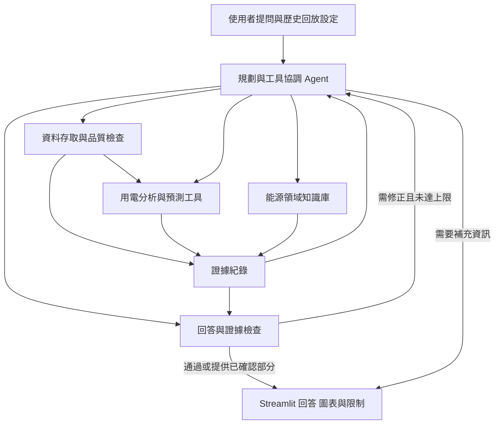

# Energy Detective

**家庭用電分析與節能決策代理人**

Energy Detective 希望讓一般家庭使用者透過自然語言理解用電紀錄：查詢特定時段用了多少電、比較用電變化、找出值得檢查的異常時段，並取得短期預測與有依據的調整建議。

本專案以 **回答可靠性與證據可追溯性** 為主要設計方向。Agent 將協調分析工具與能源領域知識，讓回答中的數字、圖表及建議能對應實際資料與來源，並在資訊不足時說明限制或進一步詢問。

> **開發狀態：**目前已整理研究背景、系統架構、分析方法、流程與評估設計。應用程式、雲端 LLM 串接、模型訓練及實驗尚未完成；以下功能與介面均為規劃內容，目前沒有可執行的 App 或實測成效。

## 專案要解決的問題

家庭用電紀錄通常包含大量時間序列數值。即使有圖表，使用者仍需要判斷比較日期是否合理、資料是否完整，以及用電增加可能代表什麼。

使用自然語言分析也需要處理可靠性問題：回答可能引用錯誤日期、混淆功率與電量，或將某個時段的用電增加直接解讀為設備故障。Energy Detective 因此將資料品質、工具計算與回答檢查納入同一套流程，讓分析依據與推論範圍可以被查核。

## 核心功能規劃

| 功能 | 使用情境 | 預計提供的結果 |
|---|---|---|
| 用電查詢 | 「這一天總共用了多少電？最高用電時段是什麼時候？」 | 指定區間的電量、趨勢與資料涵蓋情況 |
| 時段比較 | 「這一天比前一天多用了多少電？哪些時段差異最大？」 | 使用相同單位與可比較區間計算差異，呈現比較基準 |
| 異常候選分析 | 「哪些時段的用電明顯高於過去相似時段？」 | 候選時段、歷史參考範圍、判定方法與限制 |
| 下一小時預測 | 「依照目前可取得的紀錄，下一小時大約會用多少電？」 | 預測值、方法名稱，以及與簡單基準方法的比較 |
| 檢查與調整建議 | 「我應該先檢查哪些時段或設備群？還需要補充什麼資訊？」 | 結合分析結果與能源知識，提出有條件、可追溯的建議 |

初版採歷史資料回放。提問中的「今天」「昨天」以使用者選定的回放日期解讀；系統只能使用回放時點之前已知的紀錄。

## 回答如何保持可靠與可追溯

### 由工具產生分析數值

LLM 負責理解需求、選擇工具、提出澄清與整合結果。電量統計、時段比較、異常候選與預測值由既定分析工具產生，並附上時間區間、單位與計算方法。

### 保留可核對的證據

每項分析結果預計記錄資料版本、回放時點、查詢區間、使用欄位、資料品質、工具或模型版本，以及結果 ID。回答與圖表可透過這些紀錄對應同一項結果；能源知識也會保留原始出處。

### 檢查回答與證據的一致性

回答輸出前，預計檢查數字、單位、日期、增減方向、引用與資料限制。每個任務最多允許 8 次 Agent 工具呼叫及 1 次回答修正；失敗的工具呼叫也計入上限。若仍無法完成，回覆已確認的部分與限制原因。

### 清楚表達資料與推論的界線

- 缺值不視為零；部分觀測不當作完整電量。
- 區分歷史觀測、模型預測與可能原因。
- 分表用電增加時，分析停留在該設備群的範圍，必要時追問活動或設備資訊。
- 異常候選代表值得進一步檢查，原因與是否故障仍需額外證據。
- 建議是否帶來實際節電、省費或減碳，需另外進行使用者與成效驗證。

## 系統架構

系統規劃採用單一雲端 LLM Agent，協調資料工具、分析工具與小型能源知識庫，最後透過 Streamlit 呈現回答、圖表與證據。

完整模組責任與輸入輸出見 [系統設計](DESIGN.md)及[架構文件](docs/05_architecture_proposal.md)。

## 資料與分析方法

### 資料來源

初版預計使用 [UCI Individual Household Electric Power Consumption](https://archive.ics.uci.edu/dataset/235/individual+household+electric+power+consumption)，以法國單一家庭於 2006–2010 年的分鐘級歷史紀錄為基礎，整理成小時級用電分析。資料包含總功率、電壓、電流及分表電量等欄位。

目前已整理資料集說明，原始紀錄尚未下載與處理。實作時將先核對欄位、時間、單位、缺值及重複紀錄，再建立分析資料。

### 資料處理原則

- **單位換算：**總有功功率以 kW 記錄，依分鐘長度換算成 kWh；分表資料由 Wh 換算成 kWh。
- **完整性判定：**完整小時需有 60 個不同且有效的分鐘紀錄。初版不自動補值，資料不足時呈現已觀測電量、涵蓋率與限制。
- **時間一致性：**沿用資料原始時鐘，不直接轉換成台灣時間。固定回放邊界，避免使用未來觀測與訓練資訊。
- **比較條件：**明確標示比較日期、區間與基準；基準為零時不計算百分比變化。

### 模型與規則

| 項目 | 初版規劃 |
|---|---|
| 下一小時預測 | Random Forest Regressor |
| 預測特徵 | 歷史電量的 lag、移動平均與標準差，以及當時已知的日曆特徵 |
| 基準方法 | Persistence（上一小時）與 Daily Seasonal Naive（前一天同時段） |
| 異常候選 | 以歷史相似時段的 Median Absolute Deviation（MAD）建立參考並標記偏離 |
| 能源知識 | 約 10 條附來源、適用條件與推論界線的知識條目，先採概念或關鍵詞檢索 |

上述方法與參數仍需透過資料與實驗驗證。詳細計算規則見[方法與評估設計](docs/06_methods_and_evaluation.md)，知識內容見[能源領域知識](docs/08_domain_knowledge.md)。

## 技術與介面規劃

| 項目 | 方向 |
|---|---|
| 互動介面 | Streamlit，整合聊天、用電摘要、圖表及可展開的證據與限制 |
| Agent | 支援結構化 Tool Calling 的雲端 LLM API；供應商與固定模型版本待選定 |
| 數值預測 | 使用 scikit-learn 的 RandomForestRegressor 建立候選模型 |
| 圖表與文件 | Markdown、Mermaid，以及可編輯的 Word 與 PowerPoint |

介面預計讓使用者先選擇回放時間與資料範圍，再以自然語言提問。主要畫面呈現可理解的分析結果，需要時可展開查看時間、方法、資料涵蓋情況與來源。完整規劃見[技術與介面方案](docs/09_technology_and_interface.md)。

## 驗證方式

專案將分別評估數值模型與 Agent 回答，確認預測誤差、任務完成情況及證據一致性。

- **預測模型：**依時間順序切分訓練、驗證與測試資料，在共同可比較的時點，以 MAE、RMSE 及可用率比較 Random Forest 與兩個基準方法。
- **分析任務：**規劃 10 題先導與 50 題正式題目，涵蓋五類功能、一般情境、資料不足與邊界條件。
- **回答檢查效果：**固定 LLM、資料、工具與知識，比較有／無外部回答檢查與修正的兩個條件；正式題目各重複 3 次，共規劃 300 次任務執行。
- **回答品質與成本：**檢查任務完成率、數字／時間／單位正確性、證據一致性、限制處理、建議品質，以及時間與模型用量。

目前尚無實驗結果，300 次任務執行為評估規劃，也不等同於 300 次 API 呼叫。

## 專案目錄與文件

| 位置 | 內容 |
|---|---|
| [DESIGN.md](DESIGN.md) | 系統需求、元件、資料流、演算法、錯誤處理與後續實作對應 |
| [docs/](docs/) | 文獻、研究問題、架構、分析方法、能源知識與介面規劃 |
| [docs/diagrams/](docs/diagrams/) | 可持續修改的 Mermaid 架構與流程圖來源 |
| [deliverables/](deliverables/) | 可編輯的報告與簡報 |

文獻原文與排版檢查資料分別保存在本機的 `references/` 與 `tmp/`，不納入版本控制。研究文件保留引用資訊，方便依原始出處查核。

## 開發進度與後續工作

已整理完成的內容包括問題定義、文獻與領域知識、架構與模組責任、分析方法、流程與虛擬碼，以及評估設計。

接下來依序進行：

1. 取得原始資料，實作時間、單位與完整性檢查。
2. 建立查詢、比較、異常候選及預測工具，完成模型訓練與基準比較。
3. 選定雲端 LLM 服務與固定模型版本，串接工具、知識與證據紀錄。
4. 實作回答檢查及 Streamlit 互動介面。
5. 執行先導測試，凍結正式評估設定，再整理結果與限制。

安裝方式與啟動指令會在可執行程式完成後補上。

## 適用範圍

初版使用單一家庭的歷史紀錄驗證分析流程，其表現仍需在其他家庭、設備與地區重新評估。資料未提供完整的單機活動、天氣或適用費率資訊，因此設備成因、台灣電費與實際節能效益均需要額外資料與驗證。
