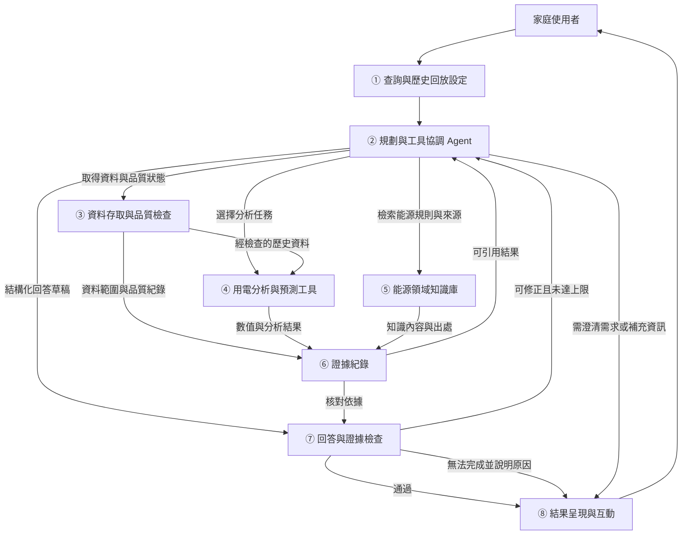

# Energy Detective：系統架構提案

本文件描述單一 Agent 與八模組的系統設計，尚未實作。

## 1. 架構方向

採用**單一規劃 Agent＋固定分析工具＋小型能源知識庫＋證據紀錄＋回答檢查**。Agent 依問題選擇工具及後續步驟；分析工具負責可重現的資料處理與計算；知識庫提供有來源的能源定義與推論限制；回覆前核對數字及證據。

目前不需要為每一種功能設置獨立 Agent。若未來實驗顯示單一 Agent 無法處理任務，再討論增加複雜度。採雲端LLM API與Streamlit介面；LLM供應商及模型版本尚未選定。

## 2. 編號系統架構圖

此圖表示模組關係與資料流，不取代後續的處理流程圖。

## 3. 八個模組與責任

| 模組 | 主要工作 | 輸入 | 輸出與邊界 |
|---|---|---|---|
| ① 查詢與歷史回放設定 | 接收問題、設定回放基準日期與可用資料截至時間，呈現目前情境 | 使用者問題、回放設定、已確認的對話參數 | 含明確時間基準的需求；「昨天」以回放日期解讀，不冒充目前即時監測 |
| ② 規劃與工具協調 Agent | 辨識任務、釐清需求、選工具、依工具結果調整步驟，整合回答 | 問題、時間基準、工具說明、已取得證據 | 工具呼叫、澄清問題、回答草稿；負責協調，不自行編造工具計算結果 |
| ③ 資料存取與品質檢查 | 讀取UCI資料、解讀時間與單位、檢查缺值及重複紀錄、限制可見歷史 | 查詢區間、欲查詢的設備群、固定回放截至時間 | 資料及品質摘要；不將缺值當零，不向分析提供回放時點後的實際觀測 |
| ④ 用電分析與預測工具 | 查詢統計、跨時段比較、異常候選辨識、下一小時預測 | 檢查後資料、任務參數、預先定義的方法 | 帶單位的結果、比較基準、方法及版本；模型與異常門檻見 [方法與評估](06_methods_and_evaluation.md) |
| ⑤ 能源領域知識庫 | 提供經整理的能源定義、資料解讀規則與有條件的檢查建議 | 相關概念、設備群或問題 | 含來源的知識條目；先使用可核對的小型知識集合，是否需要向量資料庫另評估 |
| ⑥ 證據紀錄 | 為資料狀態、分析結果及知識來源建立可引用識別碼 | ③④⑤的結構化輸出 | 可追溯的證據與查詢紀錄；保存外部工具與可核對結果，不要求記錄LLM內部思考過程 |
| ⑦ 回答與證據檢查 | 檢查時間、單位、方向、數值、引用存在與一致性，以及資料限制標記 | 回答草稿與證據紀錄 | 通過、需修正、需澄清或無法完成；引用存在不等於建議一定正確，部分合理性仍需人工評估 |
| ⑧ 結果呈現與互動 | 顯示答案、圖表、資料依據與限制，接受後續提問 | 通過檢查的回答，或有依據的澄清／限制說明 | 使用者可理解的結果；清楚標示歷史回放、預測與資料不足狀態 |

## 4. 五類功能如何進入這個架構

| 使用情境 | Agent 的工具選擇範例 | 必須帶回的依據 |
|---|---|---|
| 用電查詢 | 解讀日期→取得資料→計算電量或最高用電時段 | 區間、單位、有效資料狀態、計算結果 |
| 變化比較 | 確定兩個期間→取得資料→比較總用電量及各設備群的用電量 | 兩期間定義、比較分母、差值與方向；分母為零時不硬算百分比 |
| 異常分析 | 取得目標與參考歷史→呼叫異常工具→檢索解讀規則 | 基準、偏離程度、資料品質；不直接把異常視為故障或浪費 |
| 下一小時預測 | 檢查回放時點前資料→呼叫已準備的預測工具 | 預測對象／目標時段、資料截至時間、模型版本、必要限制 |
| 用電建議 | 依問題先選查詢／比較／異常等工具→取得能源知識→整合 | 建議對應的數據與知識，以及哪些原因仍需補查 |

這些是工具選擇示例，不規定每個問題都依同一順序跑完所有工具。資料不足、日期模糊或對話已提供結果時，Agent 應調整步驟。工具與回放限制由系統維持，不因使用者要求或LLM選擇而取得未來真實觀測。

## 5. 「證據可追溯」的具體意思

每筆回答須能核對下列必要資訊：

| 證據類型 | 建議記錄內容 |
|---|---|
| 資料依據 | 資料版本、原始來源、查詢區間、截至時間、選用欄位、有效資料狀態 |
| 分析依據 | 工具名稱、參數、計算方法／模型版本、輸出數字、單位及基準 |
| 領域依據 | 知識條目、適用條件、原始文獻或官方來源 |
| 回答對應 | 哪項數字或建議引用哪筆證據；是否為觀察、預測、假設或限制 |

圖表須與同一分析結果連結，避免文字與圖表使用不同日期。原始文獻留在本機references/；後續系統若使用自行整理的知識條目，條目與引用來源應可獨立查核，不能假設使用者已取得本機原文檔。

## 6. 可靠性檢查的能力界線

建議先使用結構化結果與明確規則，檢查可客觀核對的事項，例如：數字、單位、時間區間、增減方向、引用是否指向本次有效結果，以及欠缺資料時是否標示限制。

規則不能保證所有自由文字都正確，也不能單靠「有引用」證明推論合理。用電建議是否超出證據、是否清楚表達限制，仍需規劃人工標註案例與評分規則。若後續另用LLM輔助評分，也不能把模型自評當作唯一標準。

檢查未通過時，只在預設次數或工具預算內重試；仍有問題則回覆可確認的部分或說明原因，不無限迴圈。回答修正上限為 1 次，每任務 Agent 工具呼叫上限為 8 次，失敗呼叫也計入。

## 7. 時間與資料處理邊界

- 原始資料按其記錄時間解讀；未核對時區資訊前，不自動假設為台灣時間或UTC。
- 查詢、比較與異常分析使用回放截至時間以前的實際紀錄；尚未結束的時段須標示不完整。
- 預測結果可以指向回放時點後的一小時，但不能將該時段實際觀測當作輸入。預測與實際值的事後比對留在評估流程。
- 模型訓練、補值與特徵建立需遵守時間隔離；不在每次使用者提問時任意以完整資料重訓。
- 設備群用電紀錄可能涵蓋多種設備；沒有額外證據時，只分析設備群或區域，不確認單機原因。

## 8. 與研究問題及既有證據的對應

| 研究問題 | 核心模組 | 評估內容 |
|---|---|---|
| RQ1：下一小時預測是否優於簡單基準？ | ③④ | 時間切分、候選模型、特徵與MAE／RMSE |
| RQ2：Agent是否正確完成分析？ | ①②③④⑦⑧ | 任務題集、標準答案、時間／數值／單位正確性 |
| RQ3：建議是否有證據且揭露限制？ | ②⑤⑥⑦⑧ | 證據對應、人工評分、資料不足案例，以及同一模型有無檢查的比較 |

架構延續 [4] 的情境感知與工具協調，[5] 的結果驗證考量，以及Deep Research對量測、資料與行為的界線。這是本組提出的整合方案，尚未實作，也不宣稱已驗證其可靠性改善。

方法、資料門檻與評估配置見 [分析方法與評估計畫](06_methods_and_evaluation.md)；技術與介面規劃見 [技術方案](09_technology_and_interface.md)。
