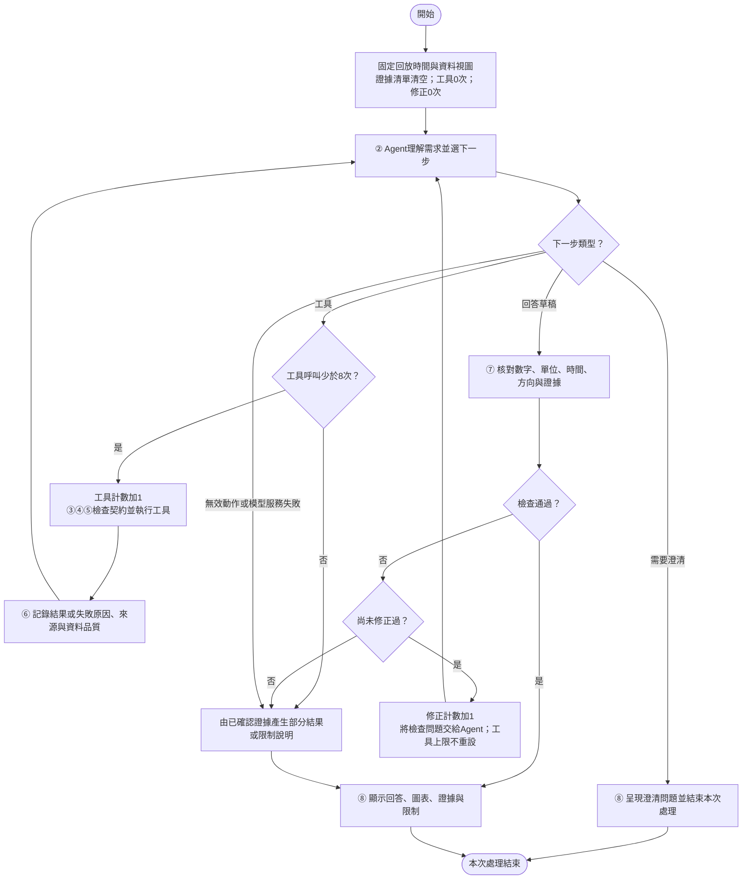

# Energy Detective：Proposed Scheme

以下為系統設計與虛擬碼，尚未實作成程式。

## 1. 系統架構與模組

完整編號架構見[系統架構提案](05_architecture_proposal.md)，圖源為[system_architecture.mmd](diagrams/system_architecture.mmd)。

①查詢與回放設定→②規劃Agent；②依需求選擇③資料、④分析及⑤能源知識工具；結果進入⑥證據紀錄；②形成回答後由⑦檢查，最後在⑧呈現。這是有條件的工具協調，不要求每題執行所有分析。

## 2. Flowchart：單次使用者任務



圖源見[agent_flowchart.mmd](diagrams/agent_flowchart.mmd)。工具結果可能是成功、部分資料、資料不足、請求被拒或執行失敗；這些狀態都要進入證據紀錄，再由Agent決定後續。澄清結束本次處理，使用者補充後另開一個任務並保留已確認的對話參數；不把等待使用者回覆當成無限迴圈。

## 3. Input / Output 與狀態

**輸入：**使用者問題Q、固定回放時間h、唯讀資料視圖V、模型與知識版本。

**輸出：**結構化回答R，包含狀態、時間解讀、可核對結果、圖表對應、證據ID、限制及必要的追問。狀態使用下列設計名稱：

| 狀態 | 意義 |
|---|---|
| ANSWER | 任務所需結果可支持，且通過回答檢查。 |
| CLARIFY | 缺少需求資訊，需要使用者補充。 |
| PARTIAL | 只能完成部分任務；清楚說明未完成部分。 |
| LIMITED | 資料、方法、預算或服務不足，無法支持所需結果。 |

狀態不是模型信心分數。PARTIAL或LIMITED不是自動算成功，仍依正式題目的預期行為評分。

## 4. 工具契約

| 工具（設計名稱） | 主要輸入 | 必要輸出／前提 |
|---|---|---|
| ReadHistoricalData | 欄位、查詢區間；由系統提供 h 與 V | 只讀時間戳<h的資料、原始單位、品質狀態、資料版本；不允許Agent改h或視圖。 |
| SummarizeEnergy | 經檢查的資料、欄位、區間 | kWh、涵蓋率、完整性、時段結果；不完整總量標為已觀測部分。 |
| ComparePeriods | 兩期間、欄位與資料 | 完整性、絕對差、有效時的百分比與分母；零分母及不完整比較回傳限制。 |
| FlagAnomalyCandidates | 目標小時與所需歷史 | 56天、同時刻及日型的有效樣本數、中位數、MAD、候選標記及限制。 |
| ForecastNextHour | h、合格模型、可見歷史 | 模型訓練截止、特徵截止、目標[h,h+1)、方法名稱與估計值；可用基準另標示。 |
| RetrieveDomainKnowledge | 概念與關鍵詞 | 知識ID、規則、適用限制與原始來源；無匹配時明示沒有取得。 |

上述是契約，不是已存在的函式。資料檢查由工具層強制執行，不能只靠LLM承諾。分析工具可在內部讀取受控資料，但不藉此突破時間或視圖限制。每次Agent發起的呼叫計入8次上限；工具內部檢查不另算Agent呼叫。

## 5. Pseudocode

### Algorithm 1：Energy Detective Agent

Input: User query Q; fixed replay time h; read-only data view V

Output: Evidence-linked response R

```text
01: C <- FreezeContext(h, V, data_version, model_version, knowledge_version)
02: E <- empty evidence registry; calls <- 0; repairs <- 0; issues <- empty
03: while true do
04:     A <- PlanNextAction(Q, C, E, issues) or SERVICE_ERROR
05:     if A.type = CLARIFY then
06:         return RenderClarification(A.required_fields, C)
07:     end if
08:     if A.type = TOOL then
09:         if calls >= 8 then
10:             return SafeTerminal(E, C, reason = TOOL_BUDGET)
11:         end if
12:         calls <- calls + 1
13:         T <- ExecuteGuardedTool(A.name, A.arguments, C) or FAILURE
14:         E <- Record(E, T, tool = A.name, arguments = A.arguments, context = C)
15:         continue
16:     end if
17:     if A.type != DRAFT then
18:         return SafeTerminal(E, C, reason = INVALID_ACTION_OR_SERVICE_ERROR)
19:     end if
20:     D <- BindDraftToEvidence(A.draft, E, C)
21:     report <- ValidateResponse(D, E, C)
22:     if report.pass then
23:         return RenderResponse(D, E, C, status = ANSWER_OR_PARTIAL)
24:     end if
25:     if repairs >= 1 then
26:         return SafeTerminal(E, C, reason = VALIDATION_FAILED)
27:     end if
28:     repairs <- repairs + 1
29:     issues <- report.issues; Q <- AddRepairInstruction(Q, issues)
30: end while
```

**輔助程序的必要行為：**

- ExecuteGuardedTool檢查名稱與參數、固定時間／視圖、欄位完整性及各工具前提；錯誤回傳結構化失敗原因。無效嘗試也計入calls，原始資料不被修改。
- PlanNextAction每次僅回傳CLARIFY、TOOL、DRAFT或錯誤；不能以空動作持續迴圈。每個繼續路徑都消耗一次工具呼叫或一次修正，因此不需要等待未知條件才終止。
- BindDraftToEvidence只接受草稿明確指定且存在的證據ID，附上核對資訊；不為缺乏依據的文字自動找一筆看似相關的引用來補上。
- ValidateResponse檢查必要欄位、時間、單位、數字、方向、圖表ID及明確限制。無法由規則涵蓋的自由文字推論，仍由後續人工評估。
- SafeTerminal用固定結構呈現已可確認的事實或限制理由，不把未通過檢查的草稿直接輸出，不進行第二次生成式修正。可引用證據不足時只說明原因。
- 回答修正後若Agent需要工具，仍使用同一calls計數；達到8次後也可用現有證據修正文句，但不能取得第9次工具結果。

### Algorithm 2：完整性檢查與電量統計

Input: Historical records D; field F; interval I; fixed context C

Output: Observed energy, completeness and evidence metadata

```text
01: if I is invalid, empty or ends after C.h then return LIMITED(INVALID_INTERVAL)
02: D <- RestrictToViewAndTime(D, C.V, timestamps < C.h, interval = I)
03: D <- DeduplicateIdenticalRecords(D); mark conflicting timestamps invalid
04: G <- ExpectedMinuteGrid(I, original_recorded_clock)
05: valid <- FiniteNonconflictingValues(D, field = F, expected_grid = G)
06: if Count(valid) = 0 then return LIMITED(NO_VALID_OBSERVATIONS)
07: coverage <- Count(valid) / Count(G)
08: if F is Global_active_power then
09:     observed_kWh <- Sum(valid.values / 60)
10: else if F is Sub_metering_1, Sub_metering_2 or Sub_metering_3 then
11:     observed_kWh <- Sum(valid.values) / 1000
12: else
13:     return LIMITED(reason = FIELD_NOT_SUPPORTED_FOR_ENERGY_SUM)
14: end if
15: complete <- AllExpectedMinutesHaveOneValidValue(G, valid)
16: label <- COMPLETE_OBSERVED if complete else PARTIAL_OBSERVED
17: return Result(observed_kWh, coverage, complete, label, unit = kWh, C)
```

若區間在h之後或完全沒有可用紀錄，工具回傳限制狀態；不能因空加總得到0就回答「沒有用電」。詢問「今天」時需先確定是截至h的已發生部分，還是整日；若縮小查詢區間，回答也須顯示縮小後的範圍。完整小時需要60個不同分鐘。完整日須檢查整個原始日期格網；日期中有缺失則不是完整日。若用電工具內部處理的是不完整區間，只能產生PARTIAL_OBSERVED，不可拿來當完整日百分比的分母。

### Algorithm 3：下一小時預測

Input: Fixed replay boundary h; visible hourly history H; model artifact M

Output: Labeled estimates for interval[h,h+1), or limitations

```text
01: H <- VisibleCompleteHoursBefore(h)
02: estimates <- empty; limitations <- empty
03: if y_(h-1) is available then add PERSISTENCE(y_(h-1)) to estimates
04: if y_(h-24) is available then add DAILY_NAIVE(y_(h-24)) to estimates
05: if M is unavailable or M.training_cutoff > h then
06:     return LabeledEstimatesOrLimit(estimates, reason = MODEL_UNAVAILABLE_AT_TIME)
07: end if
08: X <- BuildPastOnlyFeatures(H, lags = [1,2,24,168], windows = [3,24])
09: X <- AddKnownCalendarFeatures(X, target_hour = h)
10: if any required historical value is missing then
11:     return LabeledEstimatesOrLimit(estimates, reason = FEATURES_INCOMPLETE)
12: end if
13: prediction <- M.predict(X) or FAILURE
14: RecordPredictionOrFailure(estimates, limitations, prediction, M.version)
15: return Result(estimates, limitations, target = [h,h+1), cutoff = h, unit = kWh)
```

不在此程序重新訓練模型。實際目標值y_h只供事後評估取得，不進入Agent可見視圖。無RF時可呈現已標示名稱的基準，不把它稱成RF預測。此設計不產生未校準的預測區間。

### Algorithm 4：異常候選標記

Input: Complete observed energy x at hour s; visible historical hours H

Output: Candidate flag and reference evidence, or limitations

```text
01: if hour s is incomplete or not fully visible then return LIMITED(INCOMPLETE_TARGET)
02: B <- CompleteHours(H, start >= s-56 days, end <= s)
03: B <- SameHourOfDayAndWeekdayWeekendType(B, s)
04: if Count(B) < 14 then return LIMITED(INSUFFICIENT_REFERENCE)
05: m <- Median(B.energy)
06: mad <- Median(Abs(B.energy - m))
07: if mad = 0 then
08:     return DifferencesOnly(x, m, reason = ZERO_MAD)
09: end if
10: score <- 0.6745 * (x - m) / mad
11: candidate <- Abs(score) > 3.5
12: return Result(candidate, score, median = m, MAD = mad, count = Count(B),
13:               label = ANOMALY_CANDIDATE, no_confirmed_cause = true)
```

參考小時必須結束於s以前；如小時起點為s，end<=s表示不含目標小時。此處未做統計顯著性檢定，沒有真實故障或浪費標籤。MAD為零時只報差異，不強行加入任意小數分母。

## 6. 離線訓練與線上回放的分離

| 階段 | 可用資料與工作 | 必須保留的紀錄 |
|---|---|---|
| 資料準備 | 保留完整小時格網，建立有效性狀態；先定70／15／15的時間邊界 | 原始來源、版本、欄位、缺值／排除比例及日期邊界 |
| 訓練／驗證 | 以訓練標籤建模，驗證區間選擇；凍結參數後可合併前85%重訓 | 特徵定義、參數、實際套件版本、模型訓練與標籤截止時間 |
| 最終預測測試 | 每個h僅使用當時可見過去特徵，比較RF與兩基準 | 共同可用時點、各方法覆蓋率、MAE／RMSE與失敗原因 |
| Agent任務測試 | 回放點在最終測試區間；只給相應視圖，執行50題×2條件×3次 | 題目版本、模型ID、提示、輸出、工具與證據、檢查、修正及用量 |
| 獨立評分 | 評分端可讀標準答案及事後真值；不得把它送回正式測試中的Agent | 可核對計算、人工複核、各維度分數及初始評分分歧 |

正式題目與答案不能全部來自同一個LLM；不只用被測工具自己的輸出宣稱工具已正確。數值標準答案需獨立計算並抽查，建議與限制題由組員依規則複核。

## 7. 重要失敗情況

| 情況 | 預期行為 |
|---|---|
| 日期模糊 | 澄清日期，不自行使用系統今天代替歷史回放日。 |
| 資料缺失 | 顯示已觀測部分及涵蓋率，不偽裝完整量測。 |
| 百分比基準為零 | 報絕對差，百分比不適用。 |
| 詢問洗衣機／冷氣單機原因 | 說明資料僅能呈現設備群的用電情況，提出有條件的檢查方向或進一步詢問。 |
| 參考樣本不足／MAD=0 | 限制異常判定，只報可確認差異。 |
| 模型訓練截止晚於h | 不使用該RF；有基準時清楚標示，否則說明不足。 |
| 工具逾時或失敗 | 記錄失敗原因，不編造成功結果；後續仍受8次上限。 |
| 回答與證據不符 | 最多修正1次；仍不通過則提供可確認部分或限制。 |
| LLM服務尚未設定或中斷 | 回覆服務限制，記錄未完成原因，不編造工具結果。 |

## 8. 技術配置

系統採雲端 LLM API 與 Streamlit；供應商與固定模型 ID 待實作前選定。詳見 [技術與介面方案](09_technology_and_interface.md)。
